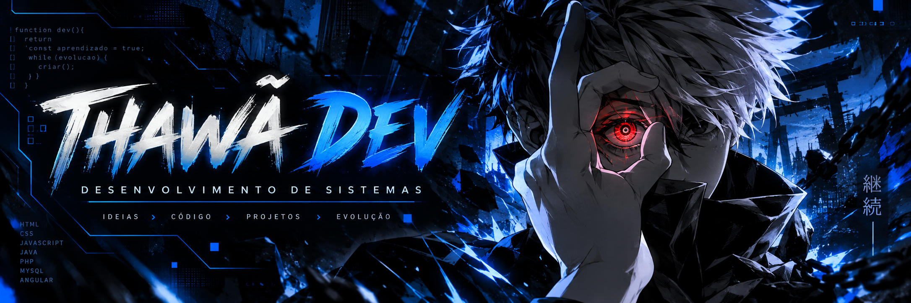

<div align="center">



<br/>

<a href="https://git.io/typing-svg"></a>

**Desenvolvimento de Sistemas • Web • Aprendizado contínuo**

<a href="https://github.com/thawa06?tab=followers"></a>
<a href="mailto:thawaluka06@gmail.com"></a>

</div>

---

## 👾 Sobre mim

```javascript
const thawã = {
  area: 'Desenvolvimento de Sistemas',
  formacao: 'Análise e Desenvolvimento de Sistemas',
  interesses: ['Desenvolvimento Web', 'Banco de Dados', 'Automação'],
  objetivo: 'Aprender, criar soluções e evoluir a cada projeto',
  modo: 'sempre aprendendo 🚀'
};
```

- 🎓 Estudante de **Análise e Desenvolvimento de Sistemas (ADS)**.
- 💻 Desenvolvo projetos acadêmicos e pessoais usando tecnologias web, Java e bancos de dados.
- 🧠 Atualmente aperfeiçoando meus conhecimentos em **Angular, JavaScript, Java e SQL**.
- 🎮 Fora do código, gosto de tecnologia, games e anime.

## ⚔️ Tecnologias e ferramentas

<div align="center">
  
</div>

## 🚀 Projetos em destaque

> Alguns trabalhos e áreas que fazem parte da minha jornada. Confira os repositórios públicos para encontrar os códigos disponíveis.

| Projeto | O que desenvolvi/estudo | Tecnologias |
|:--|:--|:--|
| 📚 **Livraria Web** | Tela de cadastro, validação de formulários e navegação em projeto em equipe. | Angular, TypeScript |
| 🛒 **Mercadinho dos Unk** | Sistema web de login, cadastro, sessões e gerenciamento de usuários. | PHP, MySQL, HTML, CSS |
| 🐾 **Canil Conectado** | Aplicação para cadastro e gerenciamento de publicações sobre animais. | Desenvolvimento Web, CRUD |
| ✅ **Automatizador de Tarefas** | Projeto em planejamento: organização de tarefas em Kanban e indicadores de produtividade. | Angular (planejado) |

<div align="center">
  <a href="https://github.com/thawa06?tab=repositories"></a>
</div>

## 📊 Estatísticas do GitHub

<div align="center">
  
  
</div>

> As estatísticas dependem de serviços externos e podem ficar temporariamente indisponíveis. A classificação das linguagens considera os repositórios analisados, não representa necessariamente meu nível de domínio.

## 🌐 Vamos nos conectar?

<div align="center">
  <a href="mailto:thawaluka06@gmail.com"></a>
  <a href="https://www.linkedin.com/"></a>
  <a href="https://github.com/thawa06"></a>
</div>

---

<div align="center">
  <i>"Cada linha de código é mais um passo na minha evolução."</i>
  <br/><br/>
  <sub>Desenvolvido por Thawã • 💙</sub>
</div>
